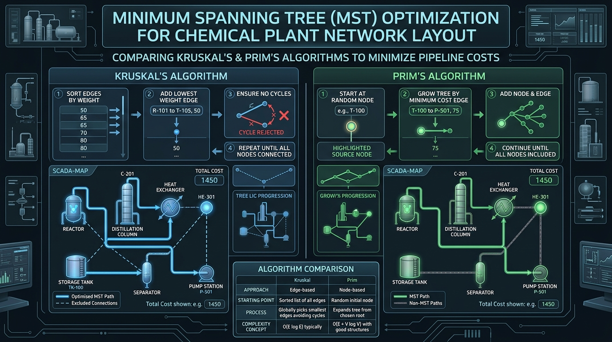

# Relatório Técnico: Otimização Topológica de Planta Química NPK

**Dimensionamento Mínimo de Malha de Utilidades e Redes SCADA com Algoritmos de Kruskal e Prim**

### Informações do Projeto

| Parâmetro | Detalhe | 
| ----- | ----- | 
| **Unidade Industrial** | Complexo Industrial NPK (Setores 100, 200 e 300) | 
| **Aplicação** | Interconexão de Tubulações (*Pipe Racks*) e Cabeamento SCADA | 
| **Método Formulado** | Árvore Geradora Mínima (MST — *Minimum Spanning Tree*) | 
| **Código do Projeto** | ECAA08-SISTEMA-SCADA | 

## 1. Contextualização e Objetivo de Engenharia

No dimensionamento eletromecânico e hidráulico de uma planta química de fertilizantes minerais (NPK), a otimização dos leitos de tubulação (*pipe racks*) e dos barramentos de comunicação industrial SCADA representa um fator crítico para a minimização de CAPEX (*Capital Expenditure*) e OPEX (*Operational Expenditure*).

O objetivo deste estudo é modelar o *layout* das unidades de processo como um grafo não direcionado e valorado $G = (V, E, w)$ e determinar a topologia de conexão de menor extensão linear contínua utilizando os algoritmos de **Kruskal** e **Prim**.

## 2. Formulação Matemática da Rede

O complexo industrial é representado por um conjunto de vértices $V$ (equipamentos dos setores 100, 200 e 300) e arestas $E$ (rotas de interconexão viáveis), onde o peso $w(e)$ quantifica a distância física em metros entre os equipamentos:

* **Vértices (**$V$**):**

  * $v_1$: `TK-301` — Tanque de Amônia Anidra ($\text{NH}_3$)

  * $v_2$: `TK-302` — Tanque de Ácido Fosfórico ($\text{H}_3\text{PO}_4$)

  * $v_3$: `R-101` — Reator *Pre-Neutralizer*

  * $v_4$: `TK-303` — Tanque Pulmão de *Slurry*

  * $v_5$: `GRAN-201` — Tambor Granulador

  * $v_6$: `SEC-201` — Secador Rotativo Térmico

## 3. Algoritmo de Kruskal (Abordagem Baseada em Arestas)

O algoritmo de Kruskal adota uma estratégia gulosa (*greedy*) baseada nas arestas do grafo. As arestas são ordenadas em ordem crescente de peso e inseridas na solução uma a uma, desde que não formem ciclos (verificado através da estrutura de dados *Union-Find*).

Para $\vert{}V\vert{} = 6$ vértices, a Árvore Geradora Mínima (MST) conterá exatamente $\vert{}V\vert{} - 1 = 5$ arestas.

| Ordem | Aresta $e$ | Trecho Conectado | Distância $w(e)$ | Ciclo Detectado? | Decisão de Projeto | 
| ----- | ----- | ----- | ----- | ----- | ----- | 
| 1 | $(v_3, v_4)$ | `R-101` $\leftrightarrow$ `TK-303` | $10\text{ m}$ | Não | **INCLUÍDA** | 
| 2 | $(v_5, v_6)$ | `GRAN-201` $\leftrightarrow$ `SEC-201` | $12\text{ m}$ | Não | **INCLUÍDA** | 
| 3 | $(v_1, v_2)$ | `TK-301` $\leftrightarrow$ `TK-302` | $15\text{ m}$ | Não | **INCLUÍDA** | 
| 4 | $(v_4, v_5)$ | `TK-303` $\leftrightarrow$ `GRAN-201` | $15\text{ m}$ | Não | **INCLUÍDA** | 
| 5 | $(v_2, v_3)$ | `TK-302` $\leftrightarrow$ `R-101` | $20\text{ m}$ | Não | **INCLUÍDA** | 
| 6 | $(v_1, v_3)$ | `TK-301` $\leftrightarrow$ `R-101` | $25\text{ m}$ | Sim ($v_1 - v_2 - v_3$) | **REJEITADA** | 
| 7 | $(v_4, v_6)$ | `TK-303` $\leftrightarrow$ `SEC-201` | $28\text{ m}$ | Sim ($v_4 - v_5 - v_6$) | **REJEITADA** | 
| 8 | $(v_3, v_5)$ | `R-101` $\leftrightarrow$ `GRAN-201` | $30\text{ m}$ | Sim ($v_3 - v_4 - v_5$) | **REJEITADA** | 
| 9 | $(v_2, v_4)$ | `TK-302` $\leftrightarrow$ `TK-303` | $35\text{ m}$ | Sim ($v_2 - v_3 - v_4$) | **REJEITADA** | 

**Comprimento total da infraestrutura via Kruskal:**

$$
W_{\text{Kruskal}} = 10 + 12 + 15 + 15 + 20 = 72\text{ metros}
$$

## 4. Algoritmo de Prim (Abordagem Baseada em Vértices)

O algoritmo de Prim expande uma única arborescência a partir de um nó raiz inicial (definido como o tanque $v_1$ / `TK-301`), adicionando a cada passo a aresta de menor peso que conecta a árvore em crescimento a um nó da fronteira não visitado.

| Iteração | Vértices na Árvore ($S$) | Arestas de Corte Elegíveis | Aresta Selecionada | Nó Adicionado | Custo | 
| ----- | ----- | ----- | ----- | ----- | ----- | 
| **Inicial** | $\{v_1\}$ | $(v_1, v_2): 15$, $(v_1, v_3): 25$ | $(v_1, v_2)$ | $v_2$ (`TK-302`) | $15\text{ m}$ | 
| **1** | $\{v_1, v_2\}$ | $(v_2, v_3): 20$, $(v_1, v_3): 25$, $(v_2, v_4): 35$ | $(v_2, v_3)$ | $v_3$ (`R-101`) | $20\text{ m}$ | 
| **2** | $\{v_1, v_2, v_3\}$ | $(v_3, v_4): 10$, $(v_3, v_5): 30$, $(v_2, v_4): 35$ | $(v_3, v_4)$ | $v_4$ (`TK-303`) | $10\text{ m}$ | 
| **3** | $\{v_1, v_2, v_3, v_4\}$ | $(v_4, v_5): 15$, $(v_4, v_6): 28$, $(v_3, v_5): 30$ | $(v_4, v_5)$ | $v_5$ (`GRAN-201`) | $15\text{ m}$ | 
| **4** | $\{v_1, v_2, v_3, v_4, v_5\}$ | $(v_5, v_6): 12$, $(v_4, v_6): 28$ | $(v_5, v_6)$ | $v_6$ (`SEC-201`) | $12\text{ m}$ | 

**Comprimento total da infraestrutura via Prim:**

$$
W_{\text{Prim}} = 15 + 20 + 10 + 15 + 12 = 72\text{ metros}
$$

## 5. Representação Esquemática da Rede e Otimização MST

*Figura 1: Diagrama conceitual comparativo entre os algoritmos de Kruskal (orientado a arestas) e Prim (orientado a vértices) aplicados à otimização da malha da planta química.*

## 6. Análise Comparativa e Decisão Industrial

> 💡 **Recomendações de Aplicação Industrial (FEED vs. Montagem em Campo)**
>
> Ambos os métodos garantem equivalência no comprimento total da malha ($72\text{ metros}$). A escolha da metodologia depende da fase do projeto de engenharia:
>
> * **Algoritmo de Kruskal** $\mathcal{O}(\vert{}E\vert{} \log \vert{}E\vert{})$**:** É ideal para a fase de projeto conceitual e básico (*FEED - Front-End Engineering Design*), onde a matriz global de distâncias entre todos os setores pode ser analisada offline para definir o orçamento de tubulação.
>
> * **Algoritmo de Prim** $\mathcal{O}(\vert{}E\vert{} + \vert{}V\vert{} \log \vert{}V\vert{})$**:** É ideal para a etapa de execução e montagem eletromecânica em campo. Permite que a equipe de instalação lance o barramento SCADA de forma contínua a partir do painel central na sala de controle (Setor 300), expandindo a rede conectada sem deixar trechos isolados durante a obra.

## 7. Referências Técnicas

1. CORMEN, T. H. et al. **Algoritmos: Teoria e Prática**. 3. ed. Rio de Janeiro: Elsevier, 2012.

2. PETERS, M. S.; TIMMERHAUS, K. D. **Plant Design and Economics for Chemical Engineers**. 5th ed. New York: McGraw-Hill, 2003.