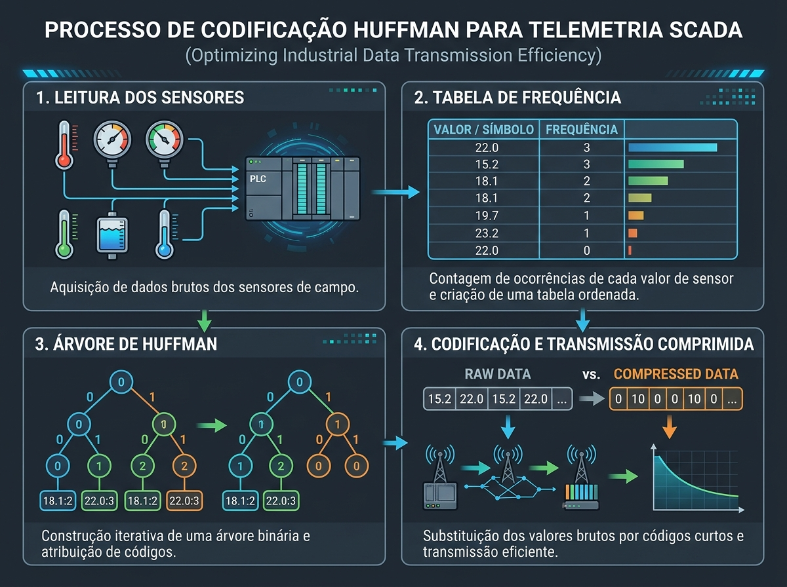

# Compressão de Telemetria via Algoritmo de Huffman no SCADA-Core

## 1. Escopo e Arquitetura do Sistema de Transmissão

O sistema **SCADA-Core** gerencia a telemetria contínua do Setor 100 (Síntese e Neutralização do Reator R-101) em tempo real, transmitindo o status operacional por redes de comunicação industrial como Modbus-RTU, PROFIBUS-DP ou OPC-UA. Em transmissões não comprimidas, o estado lógico da instrumentação de campo da norma ISA-5.1 é empacotado em palavras binárias de tamanho fixo.

Considerando os 5 instrumentos primários do laço de intertravamento e segurança funcional do Setor 100 — `PT-101` (Pressão), `TT-101` (Temperatura), `AT-101` (Detector de $\text{NH}_3$), `LT-101A` (Nível Alto) e `ESD-100` (Parada de Emergência) —, o formato fixo exige 5 bits por *frame* de telemetria.

Com altas taxas de varredura (*scan rates* de $10\text{ ms}$ a $50\text{ ms}$) em links de telemetria serial com largura de banda restrita (ex.: $9600\text{ bps}$), o envio constante de quadros redundantes causa saturação do barramento. Como plantas químicas operam em regime estável durante a maior parte do tempo, a aplicação da codificação de Huffman realiza a compressão sem perdas (*lossless*) dos dados antes do envio no barramento físico.

## 2. Modelo Probabilístico e Algoritmo de Huffman

O alfabeto discreto de mensagens $S = \{s_1, s_2, \dots, s_6\}$ representa as combinações do vetor binário de estados `[PT-101, TT-101, AT-101, LT-101A, ESD-100]`.

### Matriz de Probabilidades Operacionais

| Código do Estado | Instrumentos em Nível Lógico 1 | Condição Operacional do Processo | Probabilidade $P(s_i)$ |
| --- | --- | --- | --- |
| `00000` | Nenhum | Operação Nominal Estável | $0,900$ ($90,0\%$) |
| `00010` | `LT-101A` | Nível Alto Transitório | $0,050$ ($5,0\%$) |
| `10000` | `PT-101` | Alarme de Sobrepressão ($\ge 180\text{ bar}$) | $0,025$ ($2,5\%$) |
| `01000` | `TT-101` | Alarme de Sobretemperatura ($\ge 200^\circ\text{C}$) | $0,015$ ($1,5\%$) |
| `00100` | `AT-101` | Detector de Vazamento de Amônia ($\ge 25\text{ ppm}$) | $0,009$ ($0,9\%$) |
| `00001` | `ESD-100` | Botão de Parada de Emergência Acionado | $0,001$ ($0,1\%$)

 |

### Construção da Árvore de Huffman

1. **Combinação 1:** Os dois símbolos de menor probabilidade, `00100` ($0,009$) e `00001` ($0,001$), são unidos no nó intermediário $N_1$ com peso $0,010$.
2. **Combinação 2:** Une-se $N_1$ ($0,010$) ao símbolo `01000` ($0,015$), resultando no nó $N_2$ com peso $0,025$.
3. **Combinação 3:** Une-se $N_2$ ($0,025$) ao símbolo `10000` ($0,025$), gerando o nó $N_3$ com peso $0,050$.
4. **Combinação 4:** Une-se $N_3$ ($0,050$) ao símbolo `00010` ($0,050$), gerando o nó $N_4$ com peso $0,100$.
5. **Combinação 5:** Une-se $N_4$ ($0,100$) ao símbolo de maior frequência `00000` ($0,900$), formando a raiz da árvore binária com peso $1,000$.

Atribuindo o bit `0` às ramificações de maior probabilidade e `1` às de menor probabilidade, obtém-se o dicionário de códigos prefixados:

| Estado Original (Fixos: 5 bits) | Código de Huffman | Comprimento $l(s_i)$ |
| --- | --- | --- |
| `00000` | `0` | 1 bit |
| `00010` | `10` | 2 bits |
| `10000` | `110` | 3 bits |
| `01000` | `1110` | 4 bits |
| `00100` | `11110` | 5 bits |
| `00001` | `11111` | 5 bits

 |



### Avaliação de Desempenho e Economia de Banda

* **Entropia Teórica de Shannon ($H(S)$):**

$$H(S) = -\sum_{i=1}^{6} P(s_i) \log_2 P(s_i) \approx 0,6480 \text{ bits/símbolo}$$


* **Comprimento Médio da Palavra-Código ($L$):**

$$L = \sum_{i=1}^{6} P(s_i) \cdot l(s_i) = (0,90 \cdot 1) + (0,05 \cdot 2) + (0,025 \cdot 3) + (0,015 \cdot 4) + (0,009 \cdot 5) + (0,001 \cdot 5) = 1,1850 \text{ bits/símbolo}$$


* **Taxa de Economia de Banda (Compressão):**

$$\text{Redução de Banda} = \left( 1 - \frac{L}{L_{\text{fixo}}} \right) \times 100\% = \left( 1 - \frac{1,1850}{5} \right) \times 100\% = 76,30\%$$


## 3. Protocolo de Enquadramento e Integração CLP/SCADA

### Estrutura do Pacote de Transmissão em Campo

Para transmissão via rede serial ou soquete TCP/IP sem perda de sincronismo de bit, os dados comprimidos são encapsulados no seguinte formato de quadro:

```
+------------------+-------------------+--------------------+--------------------+
| Header (8 bits)  | Length (8 bits)   | Huffman Payload    | CRC-16 (16 bits)   |
| 0xA5 (Start Byte)| Tamanho do Payload| Bits Codificados   | Verificação Erro   |
+------------------+-------------------+--------------------+--------------------+

```

### Algoritmo de Processamento no CLP e Servidor

* **Codificação no Controlador Lógico Programável (CLP):** A cada ciclo de varredura (*scan cycle*), o CLP lê os cartões de entrada digital, mapeia o vetor de 5 bits, realiza a busca na tabela hash do dicionário de Huffman e insere os bits correspondentes no buffer circular de saída.


* **Decodificação Determinística no Servidor SCADA:** O servidor executa a leitura do fluxo binário navegando pela árvore de Huffman armazenada em memória RAM. Por se tratar de um código prefixado, a decodificação é determinística com complexidade $\mathcal{O}(k)$, onde $k$ é a quantidade de bits do código transmitido (máximo de 5 iterações por mensagem).
* **Integridade e Redundância SIS:** Se o código recebido for desalinhado por ruído eletromagnético na linha de transmissão e não corresponder a uma folha válida da árvore, a rotina de validação aciona a falha de checagem CRC-16, descarta o quadro corrompido e mantém a indicação do último estado seguro conhecido com flag de diagnóstico na tela do operador.