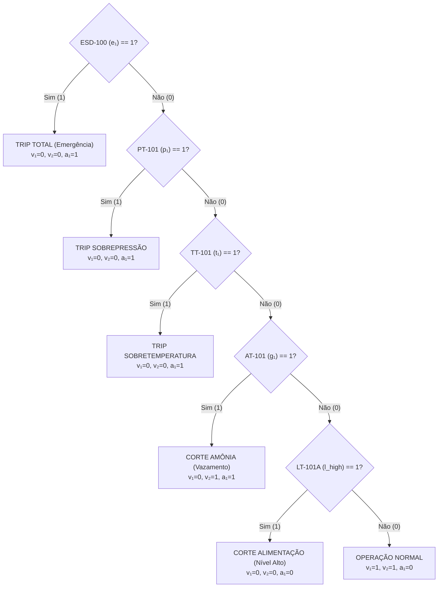
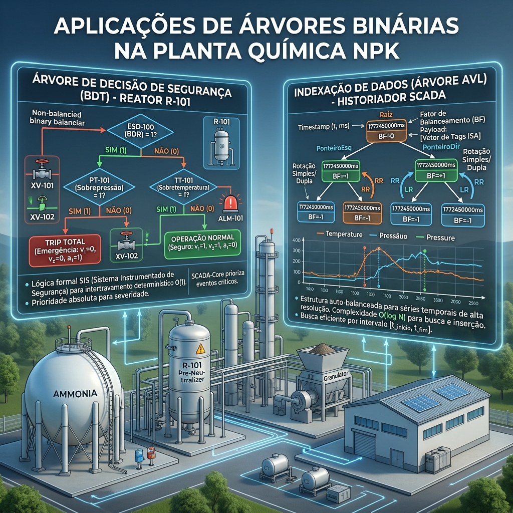

# Aplicações de Árvores Binárias na Planta de Fertilizantes NPK

---

| Especificação Técnica | Detalhes |
| :--- | :--- |
| **Unidade Operacional** | Setor 100 — Reator Pre-Neutralizer (R-101) & Historiador SCADA-Core |
| **Domínio de Engenharia** | Engenharia de Processos Químicos, Segurança Funcional (IEC 61511 / SIL-3) e Matemática Discreta |
| **Estruturas de Dados** | Árvores Binárias de Decisão (BDT) e Árvores Binárias de Busca Auto-Balanceadas (AVL) |
| **Status do Documento** | Aprovado para Implementação em Controladores Programáveis (CLP/DCS) |

---

## 1. Árvore Binária de Decisão (BDT) — Sistema Instrumentado de Segurança (SIS) do Reator R-101

### 1.1 Contextualização da Engenharia de Processos
O reator **R-101** é o elemento central do setor de síntese da planta de fertilizantes NPK, operando reações altamente exotérmicas de neutralização entre amônia anidra líquida ($\text{NH}_3$) e ácido fosfórico ($\text{H}_3\text{PO}_4$):

$$\text{NH}_3\text{ (liq)} + \text{H}_3\text{PO}_4\text{ (aq)} \longrightarrow \text{NH}_4\text{H}_2\text{PO}_4\text{ (slurry)} \quad (\Delta H^\circ = -135\text{ kJ/mol})$$

Desvios críticos nas variáveis do processo (pressão, temperatura, vazamento de gás tóxico ou nível alto) exigem tempo de resposta determinístico do sistema de intertravamento. Para evitar runaway térmico, sobrepressão explosiva ou evacuação por toxicidade (IDLH da amônia: $300\text{ ppm}$), utiliza-se uma **Árvore Binária de Decisão (BDT)** de profundidade fixa no firmware do Sistema Instrumentado de Segurança (SIS).

### 1.2 Formalização Matemática da Árvore de Decisão
Define-se a árvore de segurança como um grafo acíclico orientado $T = (V, E)$, em que:

* $V = V_{\text{interno}} \cup V_{\text{folha}}$ é o conjunto de vértices (nós).
* $V_{\text{interno}}$ contém predicados booleanos derivados da instrumentação ISA-5.1 da planta.
* $V_{\text{folha}}$ contém os estados de atuação dos atuadores de segurança (válvulas solenoide de trip $v_1, v_2$ e alarme $a_1$).
* $E$ é o conjunto de arestas direcionadas representando as transições de decisão $\{1 = \text{Verdadeiro}, 0 = \text{Falso}\}$.

### 1.3 Topologia da Árvore de Intertravamento (Mermaid)



### 1.4 Mapeamento Determinístico dos Estados dos Instrumentos ISA-5.1

A avaliação ocorre em regime de **avaliação por curto-circuito** com ordenação por gravidade de risco. A tabela abaixo especifica as transições de estado:

| Nível ($h$) | Nó de Decisão | Tag ISA-5.1 | Condição Lógica Booleana | Atuação nos Atuadores | Estado Funcional |
| :---: | :---: | :---: | :---: | :---: | :---: |
| **0 (Raiz)** | `ESD-100` | Botão de Emergência | $e_1 = 1 \implies \text{Pressionado}$ | $v_1=0, v_2=0, a_1=1$ | Parada Crítica de Emergência |
| **1** | `PT-101` | Transmissor de Pressão | $p_1 = 1 \implies P \ge 180\text{ bar}$ | $v_1=0, v_2=0, a_1=1$ | Trip por Sobrepressão R-101 |
| **2** | `TT-101` | Transmissor de Temperatura | $t_1 = 1 \implies T \ge 200^\circ\text{C}$ | $v_1=0, v_2=0, a_1=1$ | Trip por Sobretemperatura |
| **3** | `AT-101` | Analisador de Amônia Ambiente | $g_1 = 1 \implies C_{\text{NH}_3} \ge 25\text{ ppm}$ | $v_1=0, v_2=1, a_1=1$ | Isolamento de $\text{NH}_3$ Tóxica |
| **4** | `LT-101A` | Nível Alto do Reator | $l_{\text{high}} = 1 \implies \text{Nível} \ge 90\%$ | $v_1=0, v_2=0, a_1=0$ | Bloqueio Anti-Transbordamento |
| **5 (Folha)** | Estado Seguro | Todos em conformidade | $e_1=p_1=t_1=g_1=l_{\text{high}}=0$ | $v_1=1, v_2=1, a_1=0$ | Reator em Produção Normal |

### 1.5 Análise de Complexidade Computacional e Tempo Real
1. **Determinismo Temporal:** Como a árvore de decisão possui altura fixa $h = 5$, o tempo de varredura (*scan time*) de pior caso no CLP é delimitado superiormente por $O(h) = O(5) = O(1)$.
2. **Latência Escrita:** O ciclo de varredura do SIS garante um tempo de resposta inferior a $10\text{ ms}$, cumprindo os requisitos da norma IEC 61511 para malhas SIL-3.

---

## 2. Árvore Binária de Busca Auto-Balanceada (AVL) — Indexador de Séries Temporais do Historiador SCADA-Core

### 2.1 Contextualização da Engenharia de Dados Industriais
O Historiador de Processos (*Process Historian*) do SCADA-Core necessita registrar telemetria de alta frequência (amostragens a cada $10\text{ ms}$) para todos os instrumentos do setor 100 (`PT-101`, `TT-101`, `AT-101`, `LT-101A`, `LT-101B`). Para viabilizar análise de falhas pós-incidente (*Root Cause Analysis* - RCA) e gráficos de tendência em tempo real, os dados são indexados na memória principal utilizando uma **Árvore AVL**.

### 2.2 Estrutura do Nó na Memória
Cada nó $N$ na Árvore AVL armazena o *Timestamp* UNIX ($\tau \in \mathbb{N}$) como chave primária de ordenação e um vetor estruturado contendo a telemetria do processo como *payload*:

$$N = \Big\langle \tau, \; BF, \; \text{Ponteiro}_{\text{Esq}}, \; \text{Ponteiro}_{\text{Dir}}, \; \mathbf{D}(\tau) \Big\rangle$$

Onde a carga útil telemetrada é dada pelo vetor de estado:

$$\mathbf{D}(\tau) = \left[ P_{\text{PT-101}}, \; T_{\text{TT-101}}, \; C_{\text{AT-101}}, \; L_{\text{LT-101A}}, \; L_{\text{LT-101B}} \right]$$

### 2.3 Topologia e Propriedade de Balanceamento AVL

```
                       [τ = 1772450000 ms]  (BF = 0)
                          /           \
                         /             \
         [τ = 1772449900 ms]         [τ = 1772450100 ms]  (BF = 0)
            (BF = +1)                    /           \
              /                         /             \
    [τ = 1772449850 ms]      [τ = 1772450050 ms]  [τ = 1772450200 ms]
```

### 2.4 Rigor Matemático e Fator de Balanceamento ($BF$)
Para qualquer nó $n \in V$, define-se a altura da subárvore $h(T)$. O Fator de Balanceamento $BF(n)$ é rigorosamente mantido pela propriedade AVL:

$$BF(n) = h(T_{\text{direita}}) - h(T_{\text{esquerda}}) \in \{-1, \; 0, \; +1\}$$

Se após uma inserção de telemetria o valor $|BF(n)| > 1$, executa-se o rebalanceamento em tempo constante $O(1)$ através de rotações binárias:
* **Rotação Simples à Esquerda (RR):** Aplicada quando $BF(n) = +2$ e $BF(\text{filho}_{\text{dir}}) \ge 0$.
* **Rotação Simples à Direita (LL):** Aplicada quando $BF(n) = -2$ e $BF(\text{filho}_{\text{esq}}) \le 0$.
* **Rotação Dupla Direita-Esquerda (RL):** Aplicada quando $BF(n) = +2$ e $BF(\text{filho}_{\text{dir}}) < 0$.
* **Rotação Dupla Esquerda-Direita (LR):** Aplicada quando $BF(n) = -2$ e $BF(\text{filho}_{\text{esq}}) > 0$.

### 2.5 Algoritmo de Percurso e Complexidade Computacional

```
                                COMPLEXIDADE COMPUTACIONAL
┌──────────────────────────────────────┬────────────────────────┬────────────────────────┐
│ Operação de Processo                 │ Caso Médio             │ Pior Caso (Garantido)  │
├──────────────────────────────────────┼────────────────────────┼────────────────────────┤
│ Inserção de Amostra Telemetrada      │ O(log₂ N)              │ O(log₂ N)              │
│ Consulta Ponto a Ponto (Auditoria)   │ O(log₂ N)              │ O(log₂ N)              │
│ Consulta por Intervalo [τ₁ , τ₂]     │ O(log₂ N + K)          │ O(log₂ N + K)          │
└──────────────────────────────────────┴────────────────────────┴────────────────────────┘
```
*Onde $N$ representa o total de amostras indexadas em memória e $K$ o número de registros retornados no intervalo temporal $[t_{\text{início}}, t_{\text{fim}}]$.*

#### Percurso em Ordem (*In-Order Traversal*) para Recuperação Sequencial:
A recuperação de dados para os gráficos de tendência da IHM realiza um percurso em ordem na subárvore delimitada pelo intervalo $[t_{\text{início}}, t_{\text{fim}}]$:

$$\text{Percurso}(n) = \text{Percurso}(n.\text{esquerda}) \;\longrightarrow\; \text{Processa}(\mathbf{D}(n.\tau)) \;\longrightarrow\; \text{Percurso}(n.\text{direita})$$

Como a árvore binária de busca mantém a chave temporal $\tau$ estritamente ordenada, este percurso garante a extração cronológica perfeita com complexidade linear adicional $O(K)$.

---

## 3. Síntese e Comparativo de Aplicação na Planta

| Propriedade de Engenharia | Árvore Binária de Decisão (SIS) | Árvore Binária AVL (Historiador) |
| :--- | :--- | :--- |
| **Objetivo Industrial** | Intertravamento e Segurança Funcional | Armazenamento e Consulta de Télémetria |
| **Elemento Chave** | Predicado Booleano dos Sensores ISA-5.1 | Timestamp UNIX ($\tau$) em milissegundos |
| **Modificação da Estrutura** | Estática (definida em projeto de automação) | Dinâmica (inserções contínuas a $100\text{ Hz}$) |
| **Critério de Desempenho** | Tempo de execução delimitado $O(1)$ | Consultas rápidas em séries temporais $O(\log_2 N)$ |
| **Conformidade Normativa** | IEC 61511 / SIL-3 | Normas de Auditoria de Processo e RCA |

