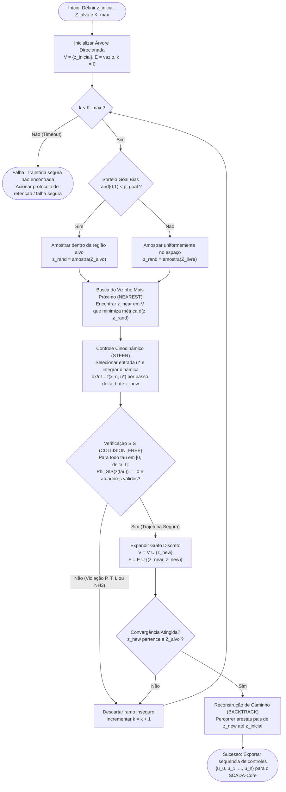

O **RRT (Árvore Aleatória de Exploração Rápida)** é um algoritmo usado para encontrar um caminho seguro entre um ponto de partida e um destino, desviando de obstáculos pelo caminho — como se fosse o crescimento das raízes de uma planta desviando de pedras no solo, ou um raio buscando o caminho mais rápido até o chão.

Para entender o nome dele na prática:

* **Árvore (*Tree*):** O algoritmo começa no ponto inicial (o "tronco") e vai criando vários caminhos que se dividem em galhos menores, sem nunca dar voltas em círculo.
* **Aleatória (*Random*):** Em vez de calcular milímetro por milímetro de um mapa (o que demoraria uma eternidade), ele sorteia pontos aleatórios no espaço para decidir para qual lado vai tentar crescer.
* **Exploração Rápida (*Rapidly-exploring*):** Como os pontos sorteados costumam cair em áreas ainda vazias do mapa, os galhos que estão na ponta são "puxados" para longe muito depressa, cobrindo grandes áreas em poucos passos.

**Como ele funciona, passo a passo:**

1. **Ponto de partida:** Você marca no mapa onde está agora.
2. **Sorteio de direção:** Você joga um dardo aleatório em qualquer lugar do mapa (de vez em quando, joga o dardo direto no destino final para não ficar rodando sem rumo).
3. **Escolha do galho mais próximo:** Você olha para a árvore de caminhos que já desenhou e encontra qual pontinha dela está mais perto desse dardo.
4. **Um passo pequeno:** A partir dessa pontinha, você dá um passo curto na direção do dardo.
5. **Teste de segurança:** Você verifica se esse passo bateu em alguma parede ou entrou em uma área proibida. Se bateu, você descarta esse passo; se o caminho estiver livre, você desenha esse novo pedacinho de galho no mapa.
6. **Repetição:** Você repete esse processo centenas de vezes até que um dos galhos encoste no objetivo. Quando isso acontece, basta seguir a linha de volta até o tronco para ter a rota completa.

Na teoria de controle e planejamento de movimento cinodinâmico, o algoritmo **Rapidly-exploring Random Trees (RRT)** é um método probabilístico de amostragem que constrói incrementalmente uma estrutura discreta — uma **árvore direcionada enraizada** $\mathcal{T} = (V, E)$ — embutida em um espaço de estados contínuo ou híbrido de alta dimensão $\mathcal{Z}$.

Diferente de métodos baseados em grades discretas fixas (como $A^*$ ou programação dinâmica clássica), cuja complexidade cresce exponencialmente com a dimensão do sistema ($O(k^d)$, a "maldição da dimensionalidade"), o RRT explora o espaço aplicando diretamente as equações diferenciais do processo. Isso garante que cada aresta gerada na árvore seja fisicamente realizável pelos atuadores da planta.

---

### 1. Interpretação Teórica no Complexo Industrial NPK

No contexto do **Reator Pre-Neutralizer (`R-101`)** do Setor 100, o RRT atua como um sintetizador de trajetórias de transição (por exemplo, alternar a campanha produtiva de MAP para DAP sem disparar intertravamentos de segurança).

* **Espaço de Estados Híbrido ($\mathcal{Z} = \mathcal{X} \times \mathcal{Q}$):**
* **Subespaço Contínuo ($\mathcal{X} \subset \mathbb{R}^5$):** Representa as variáveis termodinâmicas e químicas $\mathbf{x} = [P, T, L, C_{\text{NH}_3}, \alpha]^T$, regidas pelos balanços não lineares de massa e energia das reações exotérmicas de neutralização ($\Delta H^\circ_{\text{MAP}} = -135\text{ kJ/mol}$ e $\Delta H^\circ_{\text{DAP}} = -228\text{ kJ/mol}$).
* **Subespaço Discreto ($\mathcal{Q} \subset \{0,1\}^m$):** Representa a configuração lógica dos atuadores discretos (`XV-101`, `XV-102`, `AG-101`, `P-101`/`P-102`).

* **Espaço de Obstáculos ($\mathcal{Z}_{\text{obs}}$) e Região Segura ($\mathcal{Z}_{\text{livre}}$):**
Em robótica móvel, obstáculos são paredes físicas. No reator `R-101`, os obstáculos são **fronteiras termodinâmicas e de segurança funcional** definidas pelo Sistema Instrumentado de Segurança (SIS) via proposições booleanas da norma ISA-5.1:

$$\mathcal{Z}_{\text{obs}} = \left\{ \mathbf{z} \in \mathcal{Z} \;\middle\vert{}\; \Phi_{\text{SIS}}(\mathbf{z}) = p_1 \lor t_1 \lor g_1 \lor l_{\text{high}} \lor l_{\text{low}} \lor e_1 = 1 \right\}$$

Onde $p_1$ (`PT-101` $\ge 180\text{ bar}$), $t_1$ (`TT-101` $\ge 200^\circ\text{C}$), $g_1$ (`AT-101` $\ge 25\text{ ppm}$), $l_{\text{high}}$ ($\ge 90\%$) e $l_{\text{low}}$ ($\le 20\%$) delimitam regiões proibidas. O RRT busca um caminho estritamente contido em $\mathcal{Z}_{\text{livre}} = \mathcal{Z} \setminus \mathcal{Z}_{\text{obs}}$.
* **Propriedade do Viés de Voronoi (*Voronoi Bias*):**
A eficiência exploratória do RRT decorre da partição de Voronoi induzida pelos vértices $V$ já existentes na árvore. A probabilidade de um vértice $\mathbf{z}_{\text{near}} \in V$ ser escolhido para expansão é proporcional ao hipervolume de sua célula de Voronoi $\mathcal{V}(\mathbf{z}_{\text{near}})$. Como os nós na fronteira da árvore possuem células de Voronoi muito maiores voltadas para regiões ainda inexploradas do espaço de operação, a amostragem uniforme $\mathbf{z}_{\text{rand}} \sim \mathcal{U}(\mathcal{Z})$ "puxa" naturalmente os ramos da árvore em direção às áreas vazias, cobrindo o espaço de estados rapidamente.
* **Direção Cinodinâmica (*Kinodynamic Steering*):**
Em um processo químico com inércia térmica e capacitiva, não é possível traçar uma "linha reta" arbitrária entre dois estados. A partir do vértice mais próximo $\mathbf{z}_{\text{near}}$, o algoritmo seleciona uma ação de controle admissível $\mathbf{u} \in \mathcal{U}_{\text{adm}}$ (vazões de $\text{NH}_3$ e $\text{H}_3\text{PO}_4$ e estados de válvulas) e integra a dinâmica $\dot{\mathbf{x}} = f(\mathbf{x}, q, \mathbf{u})$ por um intervalo $\Delta t$, gerando o novo vértice $\mathbf{z}_{\text{new}}$.

---

### 2. Fluxograma de Funcionamento do Algoritmo

O diagrama abaixo ilustra o ciclo iterativo do RRT aplicado à síntese de controle do processo, destacando a integração numérica do modelo físico e a barreira lógica do SIS em cada passo de expansão.

---

### 3. Correspondência entre Primitivas do RRT e Engenharia de Controle

| Primitiva Algorítmica | Fundamento em Matemática Discreta / Controle | Papel Físico no Complexo NPK (`R-101` / `AGV-401`) |
| --- | --- | --- |
| **`SAMPLE` (com *Goal Bias*)** | Amostragem estocástica em espaço métrico híbrido com distribuição mista $(1 - p_{\text{goal}})\mathcal{U}(\mathcal{Z}) + p_{\text{goal}}\mathcal{U}(\mathcal{Z}_{\text{alvo}})$. | Equilibra exploração global de regimes operacionais inéditos com a convergência rápida para o *setpoint* da receita alvo (ex.: razão molar N/P = 1,8). |
| **`NEAREST`** | Busca de vizinho mais próximo em grafo $V$ sob métrica ponderada $d(\mathbf{z}_a, \mathbf{z}_b) = \Vert{}\mathbf{x}_a - \mathbf{x}_b\Vert{}_W + \lambda d_H(q_a, q_b)$. | Pondera grandezas físicas heterogêneas ($\text{bar}$, $^\circ\text{C}$, $\%$) e penaliza comutação desnecessária de válvulas solenoide e bombas (distância de Hamming $d_H$). |
| **`STEER`** | Problema de controle ótimo local de horizonte curto ($\Delta t$) sujeito a $\dot{\mathbf{x}} = f(\mathbf{x}, q, \mathbf{u})$. | Calcula as aberturas de válvulas e taxas de dosagem de $\text{NH}_3$ e $\text{H}_3\text{PO}_4$ que aproximam o reator de $\mathbf{z}_{\text{rand}}$ respeitando limites físicos dos atuadores. |
| **`COLLISION_FREE`** | Verificação de invariância de conjunto: $\mathbf{z}(\tau) \in \mathcal{Z}_{\text{livre}}, \;\forall \tau \in [0, \Delta t]$. | Garante que, mesmo durante o transitório entre dois nós, a liberação de calor exotérmico não ultrapasse $200^\circ\text{C}$ nem gere sobrepressão acima de $180\text{ bar}$. |
| **`BACKTRACK`** | Travessia reversa única em árvore enraizada ($\text{grau de entrada} = 1$ para todo $v \neq \mathbf{z}_{\text{inicial}}$). | Extrai a sequência determinística de comandos de controle a ser executada em malha fechada (ou como referência para um controlador MPC/PID) pelo sistema SCADA. |
